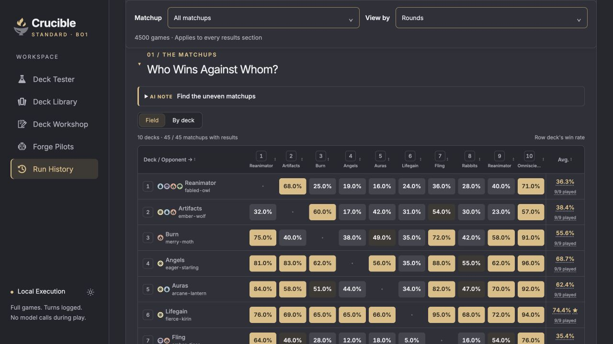
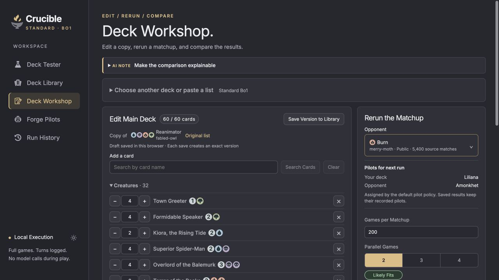
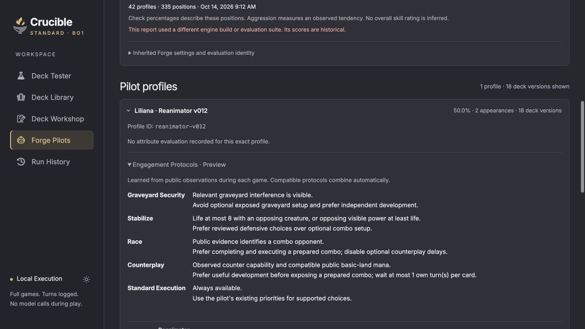

# Crucible

Crucible is a local **Standard Bo1 deck-testing workspace**. It schedules head-to-head games between exact decklists, then organizes matchup results, turn logs, and replays. **Forge** is the rules engine and automated pilot; Crucible does not simulate Magic rules itself. Results describe Forge pilot games, not expected Arena win rates.

The [solution](Crucible.slnx) contains the Blazor interface (`DeckTester`), shared backend (`Crucible.Core`), and standalone backend host (`Crucible.Service`). On macOS, Crucible Monitor manages a native backend and the .NET interface. Forge games run in Java workers. See the [documentation index](docs/README.md) for operating and development guides.

## Screenshots

**Matchup explorer** — Compare head-to-head results across a ten-deck field, including per-deck averages. The rates shown describe local Forge pilot games.



**Deck Workshop** — Edit card quantities, preview assigned pilots, and configure a matchup rerun.



**Forge Pilots** — Browse pilot profiles and inspect Reanimator's opt-in Engagement Protocols, driven by public opponent observations.



## Start

You need the .NET 10 SDK selected by [`global.json`](global.json), `tar`, and a local Arena card database at `../../standard_cards.sqlite` relative to this repository. Automatic engine setup supports macOS and Linux and needs network access for its initial downloads. The database, downloaded engine, Java runtime, results, and replays are not in Git. A clone alone does not include the local card catalog or account data.

From the repository root, run setup once, then start the service:

```sh
dotnet restore Crucible.slnx
dotnet run --project src/DeckTester/DeckTester.csproj -- --setup
./scripts/run-service.sh
```

In a second terminal, start the interface:

```sh
./scripts/run-ui.sh
```

Open [Crucible](http://127.0.0.1:5077). The service listens on `127.0.0.1:5079`; the UI listens on `127.0.0.1:5077`. Interface changes need only a UI restart. Keep the service running while games are active. Setup downloads the pinned Forge engine and a project-local Java 17 runtime, then builds the interop shim.

On macOS, [Crucible Monitor](docs/crucible-monitor.md) provides a native menu bar app that starts both hosts, reports health, requests recovery approval, and opens at login. Build it with `./scripts/package-monitor.sh`, then install the generated app in your Applications folder using the linked instructions.

The monitor runs the backend as a [native .NET AOT executable](docs/native-backend.md), while retaining the Blazor UI and Forge JVM workers. In the recorded local comparison, backend resident memory after API reads fell from 199.6 to 127.9 MiB (36%). Shell launch scripts use JIT development builds. Use one launch method at a time; the service ownership lock prevents two backends from sharing the same data directory.

To hot-swap Forge card resources, the jar, or the pilot bridge after editing them, run `./scripts/activate-forge.sh`. It compiles the bridge, copies the engine into an immutable bundle under `data/engine-bundles/`, verifies its hashes, and atomically selects it for new sessions. If more than one `forge-gui-desktop-*-jar-with-dependencies.jar` is in `vendor/`, set `MTG_FORGE_JAR` to the one to activate. Crucible and its simulation service stay running. Each session keeps its original bundle, including after pause and resume; games already in progress finish with that bundle. Old bundles remain on disk so older sessions can resume. A change to Crucible's .NET code still requires restarting its relevant host.

For access from another device on your private network, start the UI with `MTG_LAN_ADDRESS=<this-computer's-private-IPv4> ./scripts/run-ui.sh`. The service stays on loopback. The existing `MTG_*` environment variables remain supported; see [host setup](docs/host-separation.md).

## Use

1. Select two to ten exact deck versions from the library.
2. Choose an even number of games per matchup and two to four parallel games. New runs stagger initial engine starts by one second. Advanced Options includes Forge Performance Mode, which is off by default.
3. Start a run. Compare decks in the Field matrix or By deck view, filter game evidence, and open replays to inspect turns and board state. Ten decks produce 45 matchups and 9,000 scheduled games at the default 200 games per matchup.
4. Pause or resume a run without discarding completed games. Compatible completed games can be reused when a later run has the same decks and seed.

Crucible records mulligans, mana incidents, turn samples, attempt status, active runtime, and the Forge Performance Mode used for each session. Browser selections and result filters persist across navigation and refreshes. Cached games and runtime estimates stay separate by performance mode. The UI labels partial data and excludes failed or unfinished games from win rates.

Use **Deck Workshop** to save and compare custom deck versions. **Forge Pilots** shows pilot assignments, programmatic decision checks, and measured win rates from saved local sessions, with sample sizes and links to the underlying evidence. Historical pilot versions and sessions retain their recorded identities.

The default policy combines Aggro v001, Control v1, unified Reanimator v011, and Forge Default for other decks. Advanced Options offers **Standard + Engagement Protocols (Preview)**, which assigns Reanimator v012 and its five public-observation protocols, and an opt-in subtype policy with 30 additional profiles. The assignment selector in Forge Pilots only previews policies; choose the run policy in setup. [Engagement Protocols](docs/engagement-protocols.md), [subtype pilots](docs/subtype-pilots.md), and the [pilot requirements](docs/specs/04-automated-pilots.md) describe the bounded behavior and evidence.

Saved [AI notes](docs/ai-notes.md) provide attributed editorial commentary where available. They are authored records; simulations and aggregation make no model calls. The [Pilot Optimizer](docs/pilot-optimizer.md) is a separate CLI/API workflow for frozen experiments and explicit opt-in promotion.

New worker-capable Forge bundles reuse initialized Java processes within each session, up to its selected parallel-game count. Every game gets fresh match/pilot state and its own seed and replay. Workers are replaced after failures or cancellation, recycled after 32 games or high heap use, and stopped when the session ends. Older pinned bundles continue using their original fresh-process protocol. See [engine and replay contract](docs/specs/03-engine-and-replay.md) for isolation and verification details.

## Read results carefully

Runs are **exploratory**. Forge resolves complete games, but its automated decisions and every card interaction have not been independently validated for competitive accuracy. Arena Bo1 opening hands are approximated without guessing a hand smoother. Public archetype tiers, personal decks, and simulated results have separate sources; none establishes card ownership or an Arena win rate. See [implementation status](docs/implementation-status.md) and the [specifications](docs/specs/README.md) for the detailed limits.

Forge Performance Mode skips selected rules checks inside Forge. Its effect on these decks has not been validated, so compare it as a separate experimental setting. Session details and history show the saved mode; older sessions are treated as normal mode.

## Data and checks

`data/simulator.sqlite` stores deck manifests, sessions, attempts, results, and editorial notes; `data/replays/` stores game evidence. Both are excluded from Git. Simulation data goes through the service API; the UI has a separate local store for editorial notes and reads saved pilot scorecards. It does not schedule games or run Forge. Summary and replay exports remain service-only API operations. See [host separation](docs/host-separation.md) and [third-party notices](THIRD_PARTY.md).

Run focused checks from the repository root:

```sh
dotnet run --project tests/SchedulingChecks/SchedulingChecks.csproj
dotnet run --project tests/HostSeparationChecks/HostSeparationChecks.csproj
dotnet run --project tests/TableSortChecks/TableSortChecks.csproj
dotnet run --project tests/DeleteSessionChecks/DeleteSessionChecks.csproj
python3 tests/check_session_turns.py
```

The [development guide](docs/development.md) maps the additional Workshop, pilot, worker, serialization, note, and Monitor checks to their prerequisites. [Implementation status](docs/implementation-status.md) separates implemented features and recorded checks from the remaining validation gates.
